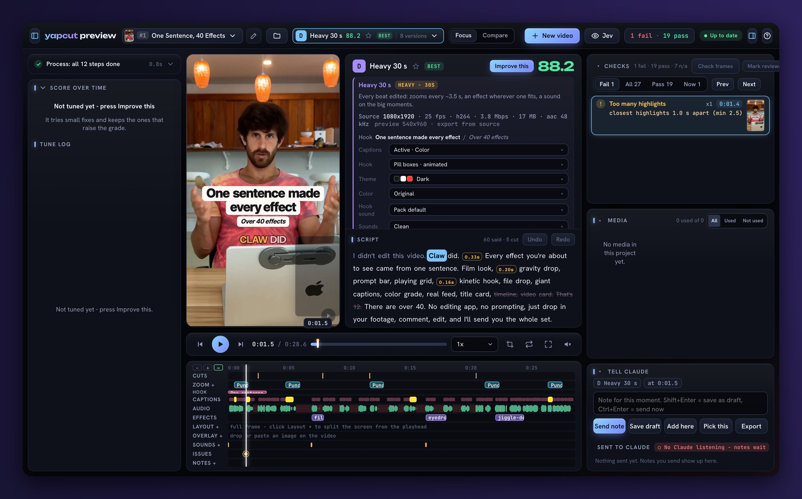
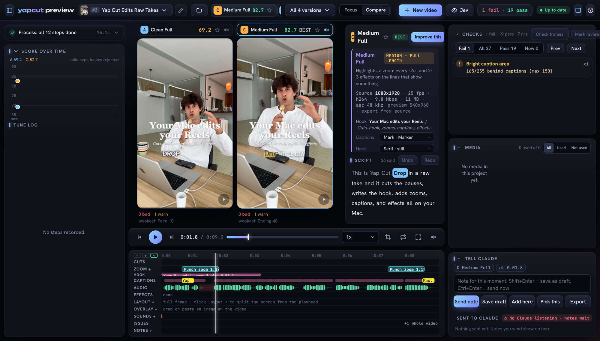
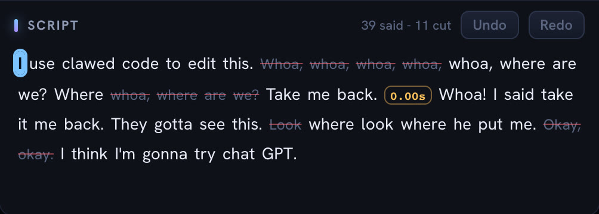
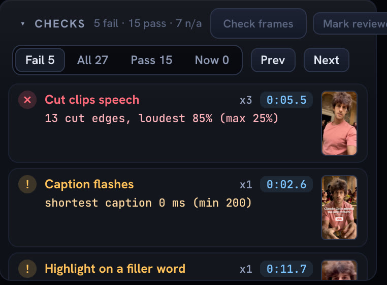

<p align="center">
  
</p>

<h1 align="center">YapCut</h1>

<p align="center">
  <b>Your raw take is already a Reel</b><br>
  Drop in a talking-head video. Get it back cut, titled, zoomed, captioned and scored. Runs on your Mac.
</p>

<p align="center">
  <a href="#install">Install</a> ·
  <a href="#one-take-in-a-dozen-edits-out">Features</a> ·
  <a href="#it-grades-every-version">The grade</a> ·
  <a href="docs/HOW-IT-WORKS.md">How it works</a> ·
  <a href="https://tools.techguyverlabs.org/t/yapcut">Tool page</a>
</p>

---

Drop a take on the page. A few minutes later you have:

- **Fumbles, repeats and long pauses cut**, the last try of a flubbed line kept
- **A hook title** written from what you actually say
- **Zooms** that punch in on the words that matter
- **Captions** timed to each spoken word, in the style you pick
- **Sound effects** on the beats, mixed under your voice
- **39 on-screen effects** the AI places where they show what you are saying
- **A grade for every version**, with what pulled it down and a button to fix it

The edit runs on your machine. The thinking is done by the AI CLI you already use: **Claude Code** or **Codex** (signed in with your ChatGPT plan). Your video never leaves your Mac.

## Install

You need a Mac with Apple silicon, [Homebrew](https://brew.sh), Google Chrome, and Claude Code or Codex.

```sh
brew install node uv ffmpeg@7
xcode-select --install          # if you don't have the command line tools yet
git clone https://github.com/royherma/yapcut.git
cd yapcut
scripts/install.sh              # packages, the word-timing model, `yapcut doctor`
yapcut preview
```

Open **http://localhost:4901** and drop a take on the page. The first take downloads the speech and word-timing models (a few GB); after that it starts right away.

**Use Claude Code?** Install it as a plugin and ask Claude to edit a take:

```sh
claude plugin marketplace add royherma/techguyver-tools
claude plugin install yapcut@techguyver-tools
```

Then: `Edit my take ~/Movies/take.mov`.

**Use Codex instead?** It works the same; YapCut picks whichever is installed. Force one with `YAPCUT_LLM=codex` or `YAPCUT_LLM=claude`.

## One take in, a dozen edits out



Every take becomes versions side by side: **Clean** (just the cut), **Light**, **Medium** and **Heavy**, each at full length, 60 s and 30 s. Play them next to each other, star the best, or press **Improve this** and it tries small fixes and keeps only the ones that raise the grade.

## Edit it like a doc



The script is the edit. Strike a word to cut it, click it again to bring it back, click a pause to change how long the gap is. Pick the caption style, hook look and theme from the menus; drag the captions, hook title and cards on the video. Every change plays right away, no render.

## 39 effects that show what you say


Lists tick off as you say each item. A number going up draws a chart. A reveal turns the lights down. The AI reads what each effect is for (`effects/catalog.mjs`) and places them on the words they fit; you can add, move or delete any of them on the timeline. Run `yapcut fx` for the full list.

## It grades every version



Each version gets a score out of 100, and every part of it says why:

| Part | What it checks | Weight |
| --- | --- | --- |
| Rule book | Captions, cuts, effects and safe areas against the checks list | 23% |
| Hook | Would the first 3 s stop someone scrolling (AI judge) | 16% |
| One idea | Is there one clear idea a newcomer gets (AI judge) | 13% |
| Structure | Does the cut play every beat its format needs, and end on the last one | 12% |
| Length | 20 to 60 s is full marks | 10% |
| Pace | 15 to 35 cuts per minute | 9% |
| Visual interest | Effects and zooms per 10 s | 9% |
| Ending | Does it end on a complete line (AI judge) | 8% |

Every failed check shows the moment it happened, what it measured and a **Fix this** button.

## Export

**Export** in the page writes the video at your source resolution: 9:16, 4:5, 1:1 or 16:9 (blurred sides), as MP4 or ProRes, or a fast 480p draft. What you see in the preview is what you get.

For one quick edit without the page: `yapcut new take.mov` writes `runs/take/out.mp4`.

## Settings

| Env var | What |
| --- | --- |
| `YAPCUT_LLM` | `claude` or `codex`. Default: whichever is installed, Claude first |
| `YAPCUT_CODEX_MODEL`, `YAPCUT_CODEX_FAST_MODEL` | Codex model for planning / for naming takes |
| `YAPCUT_CLAUDE_FAST_MODEL` | Claude model for naming takes (default `haiku`) |
| `YAPCUT_FFMPEG`, `YAPCUT_FFPROBE`, `YAPCUT_CHROME` | Where those programs are |
| `YAPCUT_SFX_DIR` | Your own sound folder |
| `TYPESAFE_API_KEY`, `SERP_API_KEY` | Optional paid add-ons: TypeSafe frame check, Google image search for picture cards. Off unless you set them |

Nothing leaves your Mac except the prompts your own AI CLI sends. With one of those two keys set, frames go to TypeSafe for the frame check, or search words go to SerpAPI, billed to your key.

Codex runs read-only with your own config ignored, and Claude runs with no MCP servers or skills, so a YapCut call never reaches your other tools. Every server YapCut starts listens on 127.0.0.1 only and refuses requests from other websites.

## License

MIT. Sounds in `sounds/openverse/` are CC0, credited in `sounds/SOURCES.csv`; `sounds/clean/` is made from scratch with ffmpeg. HyperFrames (Apache 2.0) and the Parakeet and Qwen3 models download on first use under their own licenses.
