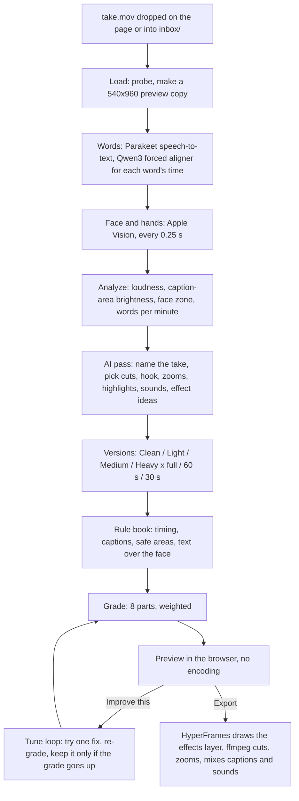

# How YapCut works

## The pieces

| Step | Code | Runs on |
| --- | --- | --- |
| Words | `lib/take.mjs` -> `vendor/caption-lab/bin/qwen_align.py` | Your Mac (MLX, PyTorch on Apple silicon) |
| Face, hands, cut-out | `bin/faces.swift`, `bin/matte.swift` | Your Mac (Apple Vision), built on first use |
| AI pass | `lib/take.mjs`, `lib/personas.mjs`, `lib/addfx.mjs` through `lib/llm.mjs` | Your Claude Code or Codex |
| The edit as numbers | `lib/edit.mjs` `layout()`: kept pieces, zooms, captions, sounds, effects | Your Mac |
| Rules and grade | `lib/rules.mjs`, `lib/grade.mjs` | Your Mac; Hook, One idea and Ending are AI-judged |
| Preview | `preview/server.mjs` + `preview/index.html` | 127.0.0.1:4901 |
| Effects | `effects/catalog.mjs` (what each is for), `effects/runtime.js` (one function each) | HyperFrames in headless Chrome |
| Export | `lib/export.mjs` | ffmpeg@7 + HyperFrames |

## The AI calls

Every call goes through `lib/llm.mjs`. It runs `claude -p` (no MCP servers, no skills) or `codex exec` (read-only sandbox, your own config ignored), whichever is installed, or the one `YAPCUT_LLM` names. Each call asks for JSON back; nothing is sent anywhere else.

| Call | What it decides |
| --- | --- |
| Name | A 2-5 word name for the take (fast model) |
| Ideas | Cuts, hook title, zooms, highlights, sounds and 3-8 effect ideas |
| Judge | Hook, One idea and Ending scores, each with its reason |
| Personas | Four editor styles cut their own version (`yapcut personas`) |
| Add here | One effect for what is said at a moment you pick |

## Adding an effect

1. Add its entry to `effects/catalog.mjs`: `id`, `what`, `dur`, `params`, and in `USE` when it fits and when to avoid it.
2. Add its draw function to `effects/runtime.js`.
3. `yapcut showcase <run> --only <id>` renders a demo into `effects/demos/`.
